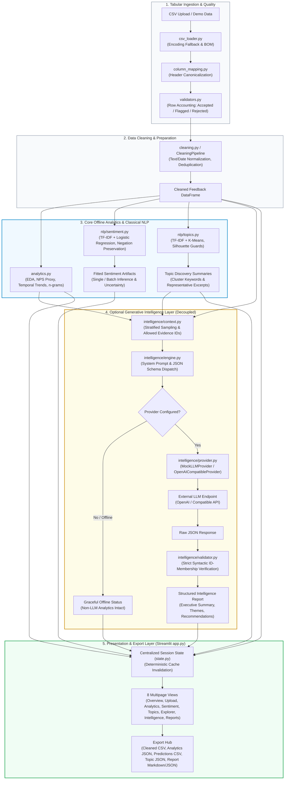

# MarketLens

> **End-to-End Marketing Intelligence Platform combining tabular ETL, classical NLP sentiment and topic discovery, and an evidence-grounded generative AI layer with an interactive Streamlit dashboard.**

[](pyproject.toml)
[](LICENSE)
[](https://github.com/ThunderSkull7/MarketLens/actions/workflows/ci.yml)
[](docs/architecture.md)
[](https://github.com/astral-sh/ruff)

---

## Table of Contents

1. [Project Overview & Problem Statement](#1-project-overview--problem-statement)
2. [Key Features](#2-key-features)
3. [Visual Tour & Screenshots](#3-visual-tour--screenshots)
4. [System Architecture](#4-system-architecture)
5. [Data Processing & Analytics Pipeline](#5-data-processing--analytics-pipeline)
6. [NLP Methodology](#6-nlp-methodology)
7. [LLM Intelligence Layer](#7-llm-intelligence-layer)
8. [Technology Stack](#8-technology-stack)
9. [Installation & Setup](#9-installation--setup)
10. [Running the Application](#10-running-the-application)
11. [Dataset Provenance & Demonstration Data](#11-dataset-provenance--demonstration-data)
12. [Model Evaluation & Limitations](#12-model-evaluation--limitations)
13. [Privacy & Security Considerations](#13-privacy--security-considerations)
14. [Project Structure](#14-project-structure)
15. [Testing Instructions & Verified Results](#15-testing-instructions--verified-results)
16. [Deployment Readiness & Instructions](#16-deployment-readiness--instructions)
17. [Roadmap & Future Improvements](#17-roadmap--future-improvements)
18. [License](#18-license)

---

## 1. Project Overview & Problem Statement

Modern marketing and product organizations collect large volumes of unstructured customer reviews, ratings, and survey responses across diverse channels. Transforming this heterogeneous feedback into strategic business intelligence presents three major engineering challenges:

1. **Data Quality & Schema Drift:** Real-world feedback CSVs arrive with varying encodings (UTF-8 with BOM, Latin-1, CP1252), duplicate entries, missing identifiers, and irregular rating scales.
2. **LLM Hallucinations & High Ingestion Costs:** Routing thousands of raw customer reviews directly into large language models is economically prohibitive, risks hallucinated metrics, and leaks unvetted customer data.
3. **Interpretability & Epistemological Boundaries:** Business decisions require clear separation between objective statistical measurements (ratings, NPS proxies), statistical machine learning predictions, and generative AI syntheses.

**MarketLens** addresses these challenges through a modular, decoupled architecture:
- **Zero-Cost Local Foundation:** Ingestion, cleaning, exploratory analytics, supervised sentiment classification, and unsupervised topic discovery run 100% locally and offline without external API dependencies.
- **Evidence-Grounded Generative Layer:** When an optional LLM provider is configured, the platform synthesizes high-level marketing insights and actionable recommendations where every single citation must pass strict ID-membership validation against pre-compiled context records.

---

## 2. Key Features

- **Robust CSV Ingestion:** Automatic multi-encoding fallback, header canonicalization, flexible rating scale normalization (1–5, 1–10, 0–10), and strict row accounting (Accepted, Flagged, Rejected).
- **Rule-Based Cleaning Pipeline:** Configurable text normalization, date standardization without synthetic sentinels, and duplicate detection preserving row traceability.
- **Exploratory Marketing Analytics:** Interactive rating distributions, estimated NPS proxies, temporal volume trendlines, product segmentations, and n-gram vocabulary frequencies.
- **Supervised Sentiment Analysis:** Negation-preserving TF-IDF vectorization paired with class-balanced Logistic Regression. Equipped with prediction margin calculations and uncertainty flags (`is_uncertain`).
- **Strict Non-Prediction Contract:** Empty, missing, and whitespace-only text inputs explicitly yield `predicted_label=None` and sentinel zero probabilities; the model never fabricates neutral predictions for invalid input.
- **Unsupervised Topic Discovery:** TF-IDF and K-Means clustering ($k \in [2, 10]$) with centroid keyword extraction, representative review selection, and automated silhouette score guards.
- **Evidence-Grounded LLM Intelligence:** Generates structured executive summaries, theme analyses, and prioritized marketing recommendations with strict citation whitelisting.
- **Multipage SaaS Dashboard:** Streamlit application providing 8 cohesive navigation views with centralized session caching and deterministic cache invalidation.
- **Comprehensive Export Hub:** Direct browser downloads for cleaned CSVs, analytics JSON summaries, sentiment prediction CSVs, topic cluster JSONs, and Markdown executive reports.

---

## 3. Visual Tour & Screenshots

MarketLens organizes its analytical capabilities across 8 dedicated views. Genuine screenshots should be captured directly from the live application using the built-in synthetic demo dataset as detailed in the [Screenshot Capture Guide](docs/screenshots/README.md).

| View | Purpose & Visible Highlights | Planned Capture File |
| :--- | :--- | :--- |
| **Overview** | Executive KPI cards, rating and sentiment distributions, key theme callouts | [`docs/screenshots/01_overview_dashboard.png`](docs/screenshots/) |
| **Data Upload & Quality** | Ingestion status, schema mapping table, row classification accounting | [`docs/screenshots/02_upload_quality_inspection.png`](docs/screenshots/) |
| **Marketing Analytics** | Dynamic filtering, rating dynamics, temporal volume trendlines, n-grams | [`docs/screenshots/03_marketing_analytics.png`](docs/screenshots/) |
| **Sentiment Analysis** | Classifier evaluation metrics, uncertainty histogram, single review test | [`docs/screenshots/04_sentiment_analysis.png`](docs/screenshots/) |
| **Topic Discovery** | K-Means topic clusters, centroid top terms, representative review quotes | [`docs/screenshots/05_topic_discovery.png`](docs/screenshots/) |
| **Feedback Explorer** | Substring search, multi-facet filtering, responsive paginated table | [`docs/screenshots/06_feedback_explorer.png`](docs/screenshots/) |
| **AI Intelligence** | Persistent Data Privacy Notice, executive synthesis, evidence citation tags | [`docs/screenshots/07_ai_marketing_intelligence.png`](docs/screenshots/) |
| **Reports & Export** | One-click downloads for Cleaned CSV, Analytics JSON, Predictions, Reports | [`docs/screenshots/08_reports_and_exports.png`](docs/screenshots/) |

---

## 4. System Architecture

The MarketLens architecture strictly isolates the core offline analytical pipeline from the optional generative AI layer.



*For complete architectural specifications, threat models, and data flows, see [`docs/architecture.md`](docs/architecture.md).*

---

## 5. Data Processing & Analytics Pipeline

### Ingestion & Validation ([`marketlens/ingestion/`](marketlens/ingestion/))
- **Encoding Resilience:** Detects and handles UTF-8 with BOM, Standard UTF-8, Latin-1, and CP1252.
- **Header Normalization:** Converts column variations (e.g., `Review Text`, `review_body`, `comment`) to canonical identifiers via regex matching.
- **Row Accounting:** Every record is partitioned into `df_validated`, `df_flagged`, or `df_rejected` with reason codes. Source CSVs are treated as immutable and never overwritten.

### Cleaning & Normalization ([`marketlens/cleaning.py`](marketlens/cleaning.py))
- **Text Cleaning:** Preserves punctuation, emojis, and polarity signals while collapsing horizontal whitespace and multiple newlines. Neutralizes leading spreadsheet formula triggers (`=,+,-,@`).
- **Rating Normalization:** Supports 1–5, 1–10, and 0–10 input ranges. Out-of-bounds ratings are converted to `None` rather than clamped, preventing synthetic sentiment distortion.
- **Deterministic Deduplication:** Flags duplicate review IDs or identical text bodies without silently deleting records.

### Core Analytics ([`marketlens/analytics.py`](marketlens/analytics.py))
- **Rating Dynamics:** Computes mean, median, standard deviation, and an estimated Net Promoter Score (NPS) proxy.
- **Temporal Trends:** Aggregates feedback volume and rating trajectories across daily, weekly, and monthly periods.
- **Text Analysis:** Extracts top unigrams and bigrams using custom domain-specific stopword exclusion.

---

## 6. NLP Methodology

### Supervised Sentiment Classification ([`marketlens/nlp/sentiment.py`](marketlens/nlp/sentiment.py))
- **Negation-Preserving Tokenizer:** Custom stopword pruning preserves critical polarity modifiers (`no`, `not`, `never`, `cannot`, `without`, `barely`).
- **Model Pipeline:** TF-IDF feature extraction (sublinear term frequency scaling, n-grams $(1, 2)$) combined with class-balanced Logistic Regression.
- **Baseline Comparison:** Evaluated against a `MajorityBaselineModel` (`DummyClassifier`) to ensure statistical gain.
- **Uncertainty Quantification:** For every inference, MarketLens computes the top class confidence and the prediction margin between the top two classes:
  $$\text{margin} = P(\text{class}_1) - P(\text{class}_2)$$
  Predictions with $\text{margin} < 0.15$ or $P(\text{class}_1) < 0.50$ are flagged as uncertain (`is_uncertain = True`).
- **Empty-Input Integrity:** Empty, missing, or whitespace-only inputs return `predicted_label=None`, `is_valid_input=False`, and sentinel zero probability vectors. Punctuation-only inputs (out-of-vocabulary) are evaluated with maximum uncertainty (`margin=0.0`, `is_uncertain=True`).

### Unsupervised Topic Discovery ([`marketlens/nlp/topics.py`](marketlens/nlp/topics.py))
- **Clustering Pipeline:** TF-IDF feature extraction combined with K-Means clustering.
- **Cluster Summarization:** Identifies top centroid keywords and extracts the most centroid-proximate customer quotes.
- **Silhouette Guards:** Silhouette scores are computed only when statistically sound ($n \ge 10$ and $2 \le k < n$). Small-corpus inputs fallback gracefully without crashing.

---

## 7. LLM Intelligence Layer

MarketLens incorporates an optional generative intelligence layer designed to enhance analytical findings without replacing classical statistical pipelines.

### Provider Abstraction ([`marketlens/intelligence/provider.py`](marketlens/intelligence/provider.py))
- **Zero-Dependency Implementation:** Uses Python's standard `urllib.request` to communicate with OpenAI-compatible REST endpoints, avoiding heavy orchestration frameworks.
- **Provider Adapters:**
  - `MockLLMProvider`: Deterministic offline provider for tests and continuous integration.
  - `OpenAICompatibleProvider`: Production adapter supporting standard OpenAI endpoints and compatible custom APIs.
- **Configuration Bridge:** Seamlessly reads API keys from OS environment variables (`OPENAI_API_KEY`, `MARKETLENS_LLM_API_KEY`) or Streamlit Community Cloud secrets (`st.secrets`).
- **Offline Resilient:** If no provider credentials exist, the engine returns a structured unavailable status while all core analytics and NLP features remain fully functional.

### Evidence Grounding & Hallucination Guard ([`marketlens/intelligence/validator.py`](marketlens/intelligence/validator.py))
- **Context Compilation:** Pre-compiles an authoritative list of allowed evidence IDs (`allowed_evidence_ids`) encompassing sampled customer review IDs and statistical metric IDs.
- **Syntactic ID-Membership Verification:** LLM output is parsed into strict Pydantic models. Any citation, quote, or recommendation referencing an ID outside `allowed_evidence_ids` is stripped.
- **Telemetry & Cost Tracking:** Computes execution latency and real token costs based on documented model pricing tables (never fabricated).

---

## 8. Technology Stack

- **Runtime:** Python 3.11+ (verified on Python 3.12)
- **Web Interface:** Streamlit (>=1.36.0) & Altair
- **Data Engineering:** Pandas (>=2.2.0), NumPy (>=1.26.0)
- **Machine Learning & NLP:** Scikit-Learn (>=1.4.0), Joblib (>=1.3.0)
- **Schema Validation & Settings:** Pydantic (>=2.7.0), Pydantic-Settings (>=2.3.0)
- **Testing & Code Hygiene:** Pytest (>=8.0.0), Ruff (>=0.5.0)

---

## 9. Installation & Setup

### Prerequisites
- Python 3.11 or 3.12 installed on your system.
- Git.

### 1. Clone the Repository
```bash
git clone https://github.com/<your-username>/MarketLens.git
cd MarketLens
```

### 2. Create and Activate Virtual Environment
```bash
# Linux / macOS
python3 -m venv .venv
source .venv/bin/activate

# Windows (PowerShell)
python -m venv .venv
.\.venv\Scripts\Activate.ps1
```

### 3. Install Package and Dependencies
```bash
# Install core package with development dependencies
pip install -e ".[dev]"
```

### 4. Configure Environment (Optional)
```bash
cp .env.example .env
```
*Note: MarketLens functions completely offline without configuring an API key. To enable generative reports, set `OPENAI_API_KEY=sk-...` in `.env` or your environment.*

---

## 10. Running the Application

Launch the Streamlit web interface:
```bash
streamlit run app.py
```

The application will open in your default browser at `http://localhost:8501`.

To test the application immediately without uploading external files, click **"Load Demo Dataset"** in the sidebar to populate the dashboard with the built-in 20-row synthetic feedback dataset.

---

## 11. Dataset Provenance & Demonstration Data

### Built-in Demonstration Dataset
- **Location:** [`data/raw/synthetic_feedback_demo.csv`](data/raw/synthetic_feedback_demo.csv)
- **Size & Format:** 20 records, CSV format.
- **Provenance:** Synthetic mock customer feedback records constructed specifically for demonstration, unit tests, and integration verification. Contains no real customer data or confidential personal information.
- **Fields:** `review_id`, `review_text`, `rating`, `review_date`, `product_id`, `verified_purchase`, `language`, `verified_label`.

### Using Custom Datasets
MarketLens accepts custom CSV feedback files up to 50 MB via the **Data Upload & Quality** dashboard view. Custom datasets require at minimum a text column and an identifier column (or will auto-assign IDs if missing).

---

## 12. Model Evaluation & Limitations

MarketLens maintains strict epistemological boundaries across all documented model metrics:

1. **Benchmark Provenance:** The external UCI Sentiment Labelled Sentences dataset is a **binary dataset** (positive and negative classes only). It contains no neutral examples. Any external benchmark evaluation must reflect this binary class distribution.
2. **External Benchmark Status:** An external multi-class benchmark has **Not been evaluated**. MarketLens does not present fabricated accuracy figures or approximations.
3. **Rating-Derived Weak Labels:** Multi-class sentiment labels generated from review ratings (1–2 $\to$ Negative, 3 $\to$ Neutral, 4–5 $\to$ Positive) are **weak labels**. They represent heuristic supervision and must not be interpreted as human-adjudicated ground truth.
4. **Evidence Validation Scope:** The LLM evidence validator enforces **syntactic ID-membership** against the compiled evidence universe. It does not perform semantic entailment verification (verifying that the text of a cited review semantically proves an observation) or cross-verify numerical narrative claims against underlying tabular data.

*For complete evaluation methodology and limitations, see [`docs/model_evaluation.md`](docs/model_evaluation.md).*

---

## 13. Privacy & Security Considerations

### LLM Data Privacy & PII Notice
- **Data Transmission:** When an external LLM provider is configured, selected customer review excerpts, record identifiers (`review_id`, `product_id`), and aggregate statistical metrics are transmitted to the provider.
- **No Automated PII Scrubbing:** Automated PII redaction (regex or NER) is **not implemented**. Raw review text excerpts enter external prompts directly. Users must not submit confidential, proprietary, or personally identifiable customer data without appropriate authorization and review of their provider's data handling terms.
- **Persistent UI Disclosure:** When a live LLM provider is configured, the AI Marketing Intelligence page displays a persistent data privacy notice informing the user of data transmission boundaries.
- **Offline Alternative:** All data cleaning, EDA analytics, supervised sentiment analysis, and topic discovery operate 100% locally and offline without data leaving the machine.

### Joblib Deserialization Security
- Serialized model artifacts loaded via `joblib.load()` execute arbitrary Python bytecode during deserialization.
- Checking object attributes after deserialization does not protect against malicious serialized payloads.
- **Security Constraint:** Only trusted model artifacts generated internally within the application's `models/` directory must be loaded. MarketLens does not allow users to upload `.joblib` model files. Cryptographic SHA-256 digest validation (`expected_sha256`) is supported before loading.

### Credential Handling
- API keys are read strictly from OS environment variables or Streamlit secrets.
- Credentials are masked (`sk-...1234`) and never printed, logged, or serialized into generated reports.

---

## 14. Project Structure

```text
MarketLens/
├── .github/
│   └── workflows/
│       └── ci.yml               # GitHub Actions CI matrix (Python 3.11, 3.12)
├── .streamlit/
│   └── config.toml              # Streamlit theme and server configuration
├── data/
│   ├── README.md                # Dataset guidelines and provenance notes
│   ├── raw/
│   │   ├── .gitkeep
│   │   └── synthetic_feedback_demo.csv  # 20-row synthetic demo dataset
│   └── processed/
│       └── .gitkeep
├── docs/
│   ├── architecture.md          # System architecture, data flow, Mermaid diagram
│   ├── data_dictionary.md       # Canonical data dictionary & field types
│   ├── model_evaluation.md      # NLP evaluation methodology and limitations
│   ├── GITHUB_RELEASE_CHECKLIST.md # Public release metadata and publication guide
│   └── screenshots/
│       └── README.md            # UI screenshot capture standards and guide
├── marketlens/                  # Core package source code
│   ├── analytics.py             # EDA, filtering, rating dynamics, text analysis
│   ├── cleaning.py              # CleaningPipeline, text/date/rating normalization
│   ├── config.py                # Pydantic settings & Streamlit secrets bridge
│   ├── exceptions.py            # Custom exception hierarchy
│   ├── logging_config.py        # Structured logging setup
│   ├── dashboard/               # Streamlit multipage application modules
│   │   ├── components.py        # Reusable UI widgets, KPI cards, Altair charts
│   │   ├── state.py             # Session state & cache invalidation manager
│   │   └── pages/               # 8 specialized dashboard views
│   ├── ingestion/               # CSV loader, column mapping, validators
│   ├── intelligence/            # LLM adapter, context prep, engine, validator
│   └── nlp/                     # Sentiment classifier & K-Means topic discovery
├── models/
│   └── .gitkeep                 # Local model artifact directory
├── notebooks/                   # Exploration scratchpads
├── reports/
│   └── .gitkeep                 # Export directory for generated reports
├── tests/                       # Automated test suite (170 tests)
│   ├── conftest.py              # Shared fixtures
│   ├── integration/             # End-to-end pipeline tests
│   └── unit/                    # Modular unit and security regression tests
├── .env.example                 # Environment variables template
├── .gitignore                   # Version control exclusion rules
├── app.py                       # Streamlit application main entry point
├── LICENSE                      # Complete MIT License (2026)
├── pyproject.toml               # Package build config & tool settings
└── README.md                    # Project landing page
```

---

## 15. Testing Instructions & Verified Results

MarketLens includes a comprehensive automated test suite spanning unit tests, integration workflows, and security regression checks.

### Running Tests Locally
```bash
# Run complete test suite
pytest -v

# Run with test execution timing
pytest -v --durations=10

# Run static linting checks
ruff check .

# Run code format verification
ruff format --check .
```

### Verified Test Results

#### 1. Remote Continuous Integration (GitHub Actions)
GitHub Actions CI is operational and verified on the `main` branch via [`.github/workflows/ci.yml`](.github/workflows/ci.yml). The latest verified remote matrix execution ([Run #42347002152](https://github.com/ThunderSkull7/MarketLens/actions/runs/42347002152)) completed with **100% passing status** across both target environments:

- **Python 3.11 Matrix Job (`ubuntu-latest`):**
  - Static Linting: `ruff check .` passed with 0 errors.
  - Format Verification: `ruff format --check .` passed.
  - Test Suite: **170 passed** in 23.36s (0 failures, 0 errors).
- **Python 3.12 Matrix Job (`ubuntu-latest`):**
  - Static Linting: `ruff check .` passed with 0 errors.
  - Format Verification: `ruff format --check .` passed.
  - Test Suite: **170 passed** in 20.61s (0 failures, 0 errors).

#### 2. Local Environment Baseline
- **Execution Environment:** Python 3.12.10 on Windows 11 AMD64.
- **Suite Breakdown (170 tests):**
  - Tabular Ingestion & Row Accounting: 45 tests passed.
  - Data Cleaning & Normalization: 25 tests passed.
  - Exploratory Analytics: 20 tests passed.
  - Classical NLP (Sentiment & Topics): 31 tests passed.
  - LLM Intelligence & Evidence Validation: 24 tests passed.
  - Streamlit Dashboard Integration (`AppTest`): 12 tests passed.
  - Security & Integrity Regressions: 5 tests passed.
  - Integration Pipelines: 8 tests passed.
- **Static Analysis & Formatting:** `ruff check .` and `ruff format --check .` passed cleanly with 0 errors.

---

## 16. Deployment Readiness & Instructions

MarketLens is architected for zero-configuration deployment on **Streamlit Community Cloud**:

### Deployment Steps
1. Push the repository to a new public GitHub repository (`main` branch).
2. Sign in to [share.streamlit.io](https://share.streamlit.io) and connect your GitHub account.
3. Select your repository and set the main file path to `app.py`.
4. *(Optional)* Under **Advanced settings $\to$ Secrets**, configure your API key:
   ```toml
   OPENAI_API_KEY = "sk-..."
   ```
5. Click **Deploy**.

### Deployment Architecture Characteristics
- **Stateless Operation:** Streamlit Cloud ephemeral instances align with MarketLens's direct user download buttons (`st.download_button`), eliminating requirements for persistent external database storage.
- **Offline Resilience:** If no secret is configured, the application deploys gracefully in offline mode.
- **Public Deployment Status:** No public deployment currently exists; this repository represents the pre-publication release candidate.

---

## 17. Roadmap & Future Improvements

- [ ] **External Multi-Class Benchmark:** Execute an independently audited 3-class sentiment benchmark on verified human-annotated customer feedback data.
- [ ] **Automated PII Redaction Module:** Implement an optional local regex and named-entity recognition (NER) redaction step prior to prompt compilation.
- [ ] **Semantic Entailment Checking:** Expand evidence validation to incorporate Natural Language Inference (NLI) models verifying semantic entailment of cited reviews.
- [ ] **Alternative Local Providers:** Expand native adapter support for self-hosted local inference runners (e.g., llama.cpp, Ollama REST).

---

## 18. License

Distributed under the MIT License. See [`LICENSE`](LICENSE) for the full text.

```text
Copyright (c) 2026 MarketLens contributors
```
