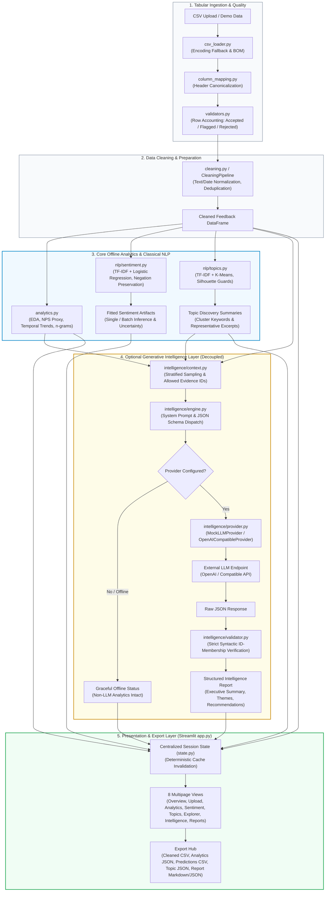

# MarketLens Architecture

*Last updated: 2026-11-07 — Batch 6.1 (Release Preparation & Final Portfolio Readiness)*

## Overview

MarketLens is an end-to-end marketing intelligence platform:
- **Batch 1:** Established project foundations and a resilient CSV ingestion and validation subsystem.
- **Batch 2:** Implemented modular data cleaning, exploratory data analysis (EDA), and core analytics.
- **Batch 3 & 3.1:** Implemented supervised sentiment analysis, unsupervised topic discovery, and a unified NLP management layer with uncertainty quantification and persistence.
- **Batch 4:** Implemented a provider-neutral, evidence-grounded LLM intelligence layer converting analytics, sentiment results, and topic clusters into structured marketing insights and recommendations.
- **Batch 5 & 5.1:** Built an interactive SaaS Streamlit application with centralized session caching across eight functional views.
- **Batch 6 & 6.1:** Final engineering QA, security audits, deployment readiness assessment, claim verification, and release preparation.

## End-to-End System Architecture

## Data Flow & Integrity Rules

1. **Raw Input Immutability**: The original CSV in `data/raw/` is **never modified**.
2. **Row Accounting**:
   - `total_source_rows`: Accurately measures total records in the source file when measurable.
   - `rows_parsed`: Count of records read into memory.
   - `rows_omitted_limit`: Tracks rows omitted when configured `max_rows` is applied.
   - `rows_accepted`, `rows_flagged`, `rows_rejected`: Explicit accounting across every record.
3. **Traceability**: Processed rows retain `_row_index`, `_status`, `_reasons`, and `is_flagged` linking directly back to ingestion records.
4. **Duplicate Detection vs. Deletion**: Records with identical IDs or ID+text are detected and marked with `is_duplicate = True`; records are never silently dropped.
5. **Rejected Record Availability**: Rejected records are excluded from analytical datasets and ML training but remain fully accessible for inspection.
6. **No Silent Rating Clamping**: `normalize_rating()` does not clamp out-of-scale ratings into valid numbers; invalid ratings become `None` and are excluded from training to prevent synthetic sentiment corruption.
7. **Weak Labels vs. Human Annotation**: Rating-derived sentiment labels are explicitly treated as weak labels, never claimed as human-verified ground truth.
8. **Leakage Prevention**: Text deduplication across partitions; TF-IDF is fitted strictly on `X_train`; no target-derived features or IDs enter model matrices.
9. **Syntactic Evidence Grounding & Scope**: The LLM is never trusted to establish its own evidence validity. Allowed evidence IDs are pre-compiled and enforced post-generation. Nonexistent or fabricated IDs are strictly stripped. *Boundary limitation*: Grounding verifies ID-membership; it does not perform semantic entailment checking of text claims or verify numerical assertions against cited reviews.
10. **Decoupled Pipeline Integrity**: LLM execution is strictly optional and independent. A missing provider, expired key, or rate limit never degrades or halts ingestion, cleaning, EDA, sentiment modeling, or topic discovery.
11. **Cost & Telemetry Fidelity**: Token counts and estimated costs are only calculated when model pricing is documented; costs and tokens are never fabricated.
12. **Model Deserialization Security**: Serialized model loading (`joblib.load`) executes arbitrary Python bytecode. Only trusted internal model artifacts from `models/` must be loaded; user uploads of `.joblib` files are prohibited. Pre-deserialization SHA-256 verification is supported when reference digests exist.
13. **Data Minimization & Privacy Disclosure**: Prompts minimize volume via review count/length caps and stratification. Automated PII redaction (regex/NER) is not implemented; raw review excerpts and record IDs are included in prompts.

## Epistemological Distinctions

MarketLens enforces rigorous boundaries between data sources and interpretations:
- **Human Ground-Truth (if any):** Direct human-adjudicated annotations.
- **Rating-Derived Weak Labels:** Algorithmic heuristics (1-2 neg, 3 neu, 4-5 pos) subject to user rating noise and grade inflation.
- **Classical ML Predictions:** Statistical supervised/unsupervised model outputs with calibrated confidence and uncertainty margins.
- **LLM-Generated Interpretations:** Algorithmic syntheses grounded strictly in provided evidence; never presented as unverified objective facts.

## Key Modules

| Path | Responsibility |
|---|---|
| `marketlens/config.py` | Environment-based settings (`MARKETLENS_*` prefix, `.env`, LLM configs, Streamlit secrets bridge) |
| `marketlens/logging_config.py` | Structured logging (INFO progress, WARNING quality, ERROR failures) |
| `marketlens/exceptions.py` | Custom exception hierarchy including `LLMError` subclasses |
| `marketlens/ingestion/csv_loader.py` | Encoding-aware CSV loading, file-type checks |
| `marketlens/ingestion/column_mapping.py` | Header normalisation, duplicate detection, column mapping |
| `marketlens/ingestion/validators.py` | Record/data validation, quality metrics, rating scales |
| `marketlens/ingestion/__init__.py` | Pipeline orchestration (`ingest()`) and row accounting |
| `marketlens/cleaning.py` | Text/date/rating normalization, duplicate detection, `CleaningPipeline` |
| `marketlens/analytics.py` | EDA summaries, n-gram frequencies, composable filtering, aggregations |
| `marketlens/nlp/dataset.py` | Weak label generation, text deduplication, stratified train/test split |
| `marketlens/nlp/sentiment.py` | Majority baseline, TF-IDF + Logistic Regression, negation-preserving stopwords, multi-metric evaluation, joblib serialization |
| `marketlens/nlp/topics.py` | TF-IDF + K-Means clustering, centroid top terms, representative texts, silhouette guards |
| `marketlens/nlp/unified.py` | `NLPManager` unifying model training, evaluation, single/batch prediction, and persistence |
| `marketlens/nlp/__init__.py` | NLP package public interface |
| `marketlens/intelligence/schemas.py` | Pydantic models for ExecutiveSummary, Insights, Recommendations, Telemetry, and Report |
| `marketlens/intelligence/provider.py` | Provider abstraction, `MockLLMProvider`, `OpenAICompatibleProvider`, token cost estimator |
| `marketlens/intelligence/context.py` | Stratified review sampling, data minimization, allowed evidence ID compilation |
| `marketlens/intelligence/validator.py` | Post-generation evidence grounding, hallucination removal, recommendation validation |
| `marketlens/intelligence/engine.py` | `IntelligenceEngine` orchestrating context, bounded retries, schema parsing, and execution metadata |
| `marketlens/intelligence/persistence.py` | Report serialization and deserialization (`save_intelligence_report`, `load_intelligence_report`) |
| `marketlens/intelligence/__init__.py` | Intelligence layer public interface |
| `marketlens/dashboard/state.py` | Centralized session state management & deterministic cache invalidation |
| `marketlens/dashboard/components.py` | Reusable SaaS UI components (KPI cards, Altair charts, pagination, empty states) |
| `marketlens/dashboard/pages/` | Multipage implementations (Overview, Upload, Analytics, Sentiment, Topics, Explorer, Intelligence, Reports) |
| `app.py` | Streamlit entrypoint coordinating navigation, state initialization, and page routing |

## Strict Scope Boundaries (Enforced)

The intelligence layer does **not** implement:
- Heavy agent or orchestration frameworks (LangChain, CrewAI, AutoGen)
- Distributed infrastructure (FastAPI, PostgreSQL, Redis, Celery, Docker, Kubernetes)
- Uncontrolled autonomous tool execution or web browsing
- Retraining of sentiment/topic models inside LLM modules
